# 📓 Notion CRM Automation
### Automated Lead Management CRM using n8n & Notion

An automated Lead Management CRM built with **n8n and Notion** to organize customer information, automate lead record creation, and manage business inquiries in a centralized workspace.

---

## 📌 Project Overview

This project demonstrates how businesses can connect n8n with a Notion CRM database to automate customer lead management.

When customer lead information is received, the workflow processes the data, generates an AI-powered lead summary when the AI processing step is connected, and creates a corresponding record in the Notion database.

The goal is to reduce manual data entry and make customer information easier to manage.

## 🎯 Business Problem

Businesses receive customer inquiries from different sources and need an organized way to manage potential customers.

Manual lead management can cause:

- Repetitive manual data entry.
- Disorganized customer information.
- Difficulty tracking potential customers.
- Time-consuming lead management.
- Inconsistent CRM records.

## 💡 Automation Solution

I developed an n8n workflow integrated with Notion to automate the creation of customer lead records.

The system:

- Receives customer lead information.
- Processes and organizes lead details.
- Generates a short AI lead summary.
- Connects to the Notion CRM database.
- Creates a new database page.
- Stores customer information in structured properties.

## ⚙️ Workflow Architecture

```mermaid
flowchart TD
    A["👤 Customer Lead Information<br/>Name, Email, Service & Message"]
    B["⚙️ Webhook Trigger<br/>Receive Lead Data"]
    C["📝 Edit Fields<br/>Format & Organize Lead Information"]
    D["🤖 AI Lead Summary<br/>Analyze & Summarize Customer Lead"]
    E["📤 Notion Create Database Page<br/>Send Lead Information to Notion"]
    F["🗂️ Notion CRM Database<br/>Store Customer Information"]
    G["📊 Organized Customer Records<br/>Manage & Track Leads"]

    A --> B
    B --> C
    C --> D
    D --> E
    E --> F
    F --> G

    H["🔗 n8n Automation"] -.-> B
    I["🧠 AI Model<br/>Google Gemini / OpenAI"] -.-> D
    J["📚 Notion Integration"] -.-> E

    style A fill:#E1F5FE,stroke:#0288D1,stroke-width:2px,color:#01579B
    style B fill:#E8EAF6,stroke:#3949AB,stroke-width:2px,color:#1A237E
    style C fill:#FFF3E0,stroke:#FB8C00,stroke-width:2px,color:#E65100
    style D fill:#F3E5F5,stroke:#8E24AA,stroke-width:2px,color:#4A148C
    style E fill:#E0F2F1,stroke:#00897B,stroke-width:2px,color:#004D40
    style F fill:#E8F5E9,stroke:#43A047,stroke-width:2px,color:#1B5E20
    style G fill:#C8E6C9,stroke:#2E7D32,stroke-width:2px,color:#1B5E20
    style H fill:#ECEFF1,stroke:#546E7A,stroke-width:2px,color:#263238
    style I fill:#FCE4EC,stroke:#D81B60,stroke-width:2px,color:#880E4F
    style J fill:#FFF9C4,stroke:#F9A825,stroke-width:2px,color:#795548
```

## 🔄 Workflow Explanation

| Step | Node | Function |
|---|---|---|
| 1 | Webhook Trigger | Receives customer lead information |
| 2 | Edit Fields | Organizes and prepares lead data |
| 3 | AI Lead Summary | Generates a short inquiry summary |
| 4 | Notion Create Database Page | Creates a new CRM record |
| 5 | Notion CRM Database | Stores customer information |

## ✨ Key Features

- Automated CRM record creation.
- Centralized lead management.
- Structured customer information.
- Notion database integration.
- Organized lead tracking.
- AI-generated lead summaries.

## 🗄️ Notion CRM Database Structure

The CRM database includes these properties:

| Property | Description |
|---|---|
| Name | Customer name |
| Email | Customer email |
| Service | Requested service |
| Message | Customer inquiry |
| Status | Lead status |
| AI Summary | Summary of customer inquiry |

## 🛠️ Technologies Used

- **n8n** – Workflow automation.
- **Notion** – CRM database and lead management.
- **Notion API** – Communication with Notion.
- **Webhooks** – Lead data collection.
- **AI** – Lead inquiry summarization.
- **REST API** – Application integration.
- **JSON** – Structured data processing.

## 📸 Workflow Screenshots

### 1. Complete n8n Workflow

.png)

### 2. Notion Create Database Page Node

.png)

### 3. Notion CRM Database

.png)

### 4. Successful Workflow Execution

.png)

## 🧪 Testing & Results

Successfully connected n8n with the Notion CRM database and tested the creation of a sample lead record:

**Test Record:** `Test Lead - Ahmad Khan`

The test demonstrated successful automated record creation and structured lead management in Notion.

## 📚 Project Documentation

Read the complete [Project Walkthrough](https://github.com/syedaliabbashamdani/notion-crm-automation/blob/d72bedc6ac3c42a71085ccf7f4dd75d97bd6902b/PROJECT-WALKTHROUGH.md)
to understand the workflow architecture, individual steps,
technologies, and business applications.

## 📈 Business Benefits

- Reduces repetitive manual data entry.
- Keeps customer information organized.
- Simplifies lead management.
- Creates structured CRM records.
- Connects automation with a familiar business workspace.
- Provides a foundation for more advanced CRM workflows.

## 💼 Business Applications

This type of automation can be adapted for:

- Small businesses.
- Freelancers and agencies.
- Digital marketing agencies.
- Sales teams.
- Service-based businesses.
- Customer inquiry management.

## 🚀 Want a Similar CRM Automation?

I can build custom n8n automation systems that connect your business tools and simplify your daily operations.

**Available services:**
- n8n Workflow Automation
- Notion CRM Automation
- AI Lead Management
- API Integrations
- AI Agents and Chatbots
- Business Process Automation

**Developer:** Syed Ali Abbas  
**GitHub:** https://github.com/syedaliabbashamdani

---

⭐ If you find this project useful, feel free to explore my other AI automation projects.

